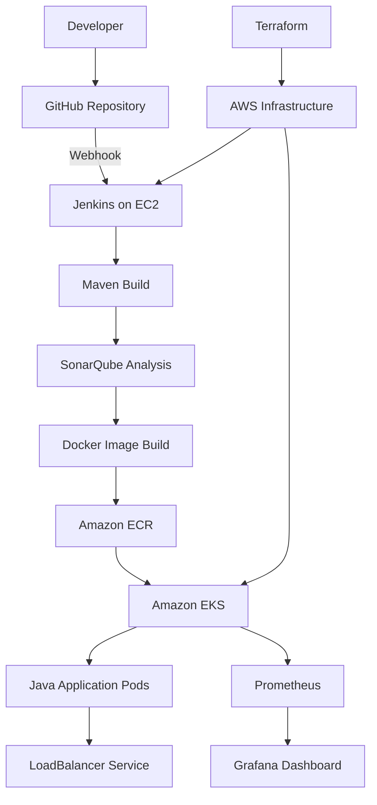

# 🚀 Cloud-Native CI/CD Platform on AWS EKS

An end-to-end DevOps project that automates Java application building, code quality analysis, Docker image publishing, Kubernetes deployment, and monitoring using AWS and open-source DevOps tools.

## 📌 Project Overview

This project demonstrates an automated CI/CD pipeline for deploying a Java application to Amazon Elastic Kubernetes Service (EKS).

Whenever code is pushed to GitHub, a webhook triggers Jenkins. Jenkins builds the Java application using Maven, analyzes the code using SonarQube, builds a Docker image, pushes it to Amazon Elastic Container Registry (ECR), and updates the application deployment on EKS.

Prometheus and Grafana provide Kubernetes and resource monitoring.

## 🎯 Project Objectives

- Automate application build and deployment using Jenkins.
- Integrate SonarQube for code quality analysis.
- Containerize the Java application using Docker.
- Store and version Docker images in Amazon ECR.
- Deploy the application on Amazon EKS.
- Monitor Kubernetes resources using Prometheus and Grafana.
- Provision AWS infrastructure using Terraform.

## 🛠️ Tools & Technologies

| Technology | Purpose |
|---|---|
| AWS EC2 | Jenkins server and DevOps tools |
| Terraform | AWS infrastructure provisioning |
| Amazon VPC | Network infrastructure |
| Amazon EKS | Kubernetes cluster |
| Amazon ECR | Docker image registry |
| Jenkins | CI/CD automation |
| GitHub | Source code management and webhook triggers |
| Maven | Java application build |
| SonarQube | Code quality analysis |
| Docker | Application containerization |
| Kubernetes | Application deployment and orchestration |
| Helm | Monitoring stack installation |
| Prometheus | Metrics collection |
| Grafana | Monitoring dashboards |

## 🏗️ Architecture



## 🔄 CI/CD Pipeline Workflow

### 1. Source Code Management
The Java application and pipeline configuration are maintained in GitHub. A GitHub webhook triggers Jenkins when changes are pushed.

### 2. Continuous Integration with Jenkins
Jenkins checks out the source code and executes the pipeline stages automatically.

### 3. Maven Build
Maven compiles the Java application and packages it into a JAR file.

### 4. Code Quality Analysis
SonarQube analyzes the application source code as part of the pipeline.

### 5. Docker Image Creation
Jenkins builds a Docker image containing the Java application.

### 6. Push to Amazon ECR
Jenkins authenticates with Amazon ECR and pushes the versioned image to the private repository.

### 7. Deployment to Amazon EKS
Jenkins updates the Kubernetes Deployment with the newly published image and checks the rollout status.

### 8. Monitoring
Prometheus collects Kubernetes and infrastructure metrics. Grafana provides dashboards for visualizing resource utilization and cluster health.

## 📁 Project Structure

```text
cloud-native-cicd-platform/
├── app/
│   ├── src/
│   ├── pom.xml
│   └── Dockerfile
├── terraform/
│   ├── main.tf
│   ├── vpc.tf
│   ├── subnet.tf
│   ├── internet-gateway.tf
│   ├── route-table.tf
│   └── ...
├── kubernetes/
│   ├── deployment.yaml
│   └── service.yaml
├── monitoring/
├── Jenkinsfile
└── README.md
```

*Note: Adjust the Terraform filenames and folder structure to match the actual files in the repository.*

## ⚙️ Prerequisites

- AWS account with permissions to provision the required resources.
- AWS CLI configured with appropriate credentials or an IAM role.
OAOAOA- Terraform installed.
- Git and Docker installed.
- Java 17 and Maven installed.
OAOAOA- Jenkins with the required pipeline and SonarQube integration configured.
- An Amazon EKS cluster and worker nodes.
- An Amazon ECR repository.
- Helm and kubectl for Kubernetes and monitoring management.
OAOAOA
## 🚀 Deployment & Setup

### Step 1: Clone the Repository

```bash
git clone https://github.com/rahul-chaudhari-collab/cloud-native-cicd-platform.git
cd cloud-native-cicd-platform
```

### Step 2: Provision AWS Infrastructure
OAOAOA
OAOAOAOAOAOAOAOAOANavigate to the Terraform directory and initialize Terraform:

```bash
OAOAOAcd terraform
terraform init
terraform validate
terraform plan
```

Review the proposed infrastructure changes before applying them. Use the Terraform configuration and variables appropriate for your AWS environment.

### Step 3: Build the Java Application

```bash
cd ../app
mvn clean package
```
OAOAOA
The generated JAR is used to build the Docker image.

### Step 4: Configure Jenkins
OAOAOA
OAOAOACreate a Jenkins Pipeline job using **Pipeline script from SCM** and configure:

- Repository URL: `https://github.com/rahul-chaudhari-collab/cloud-native-cicd-platform.git`
- Branch: `main`
- Script path: `Jenkinsfile`

Configure the required AWS access, Docker permissions, Kubernetes access, SonarQube server and Jenkins credentials. Do not commit credentials or tokens to GitHub.

### Step 5: Configure Amazon ECR and EKS

Ensure the ECR repository exists and the Jenkins execution environment has permission to push images. Configure kubectl access to the target EKS cluster and ensure the Kubernetes Deployment references the correct ECR image.

### Step 6: Trigger the Pipeline

Push a code change to GitHub or run the Jenkins job manually. Verify the pipeline stages and confirm that the new image is deployed successfully.

### Step 7: Install Monitoring with Helm

The monitoring stack used in this project is installed with the Prometheus Community Helm chart:

```bash
helm repo add prometheus-community \
  https://prometheus-community.github.io/helm-charts

helm repo update

helm install monitoring \
  prometheus-community/kube-prometheus-stack \
  --namespace monitoring \
  --create-namespace
```

Check the monitoring pods:

```bash
kubectl get pods -n monitoring
```

## ✅ Validation

Check the Kubernetes application deployment:

```bash
kubectl get deployments
kubectl get pods
kubectl get services
```

Check the monitoring stack:

```bash
kubectl get pods -n monitoring
kubectl get services -n monitoring
```

The application Deployment should have two available replicas, and the monitoring components should become ready after initialization.

## 📊 Monitoring with Grafana

Grafana is used to view Kubernetes resource metrics and cluster health.

To access Grafana locally through a port-forward:

```bash
kubectl port-forward -n monitoring \
  svc/monitoring-grafana 3000:80
```

Open `http://localhost:3000` in a browser on the machine where the port-forward is running.

Retrieve the initial administrator password directly from the Kubernetes Secret:

```bash
kubectl get secret -n monitoring monitoring-grafana \
  -o jsonpath="{.data.admin-password}" | base64 -d
```

Keep the password private. Do not expose Grafana or Jenkins directly to the public internet without appropriate access controls.

## 🔐 Security Considerations

- Use IAM roles and least-privilege permissions wherever possible.
- Keep AWS credentials, SonarQube tokens and other secrets out of Git.
- Restrict inbound access to Jenkins, Grafana and SonarQube.
- Use private image repositories and controlled Kubernetes access.
- Review AWS resource costs before leaving the infrastructure running.

## 💡 Key Learnings

- Implementing an automated Jenkins CI/CD pipeline.
- Building Java applications with Maven.
- Integrating SonarQube into CI/CD.
- Building and publishing Docker images to Amazon ECR.
- Deploying applications on Amazon EKS.
- Managing Kubernetes resources using kubectl.
- Installing monitoring components with Helm.
- Visualizing cluster metrics using Prometheus and Grafana.
- Provisioning cloud infrastructure with Terraform.

## 👨‍💻 Author

**Jayesh Ghade**

GitHub: [rahul-chaudhari-collab](https://github.com/rahul-chaudhari-collab)

Project Repository: [cloud-native-cicd-platform](https://github.com/rahul-chaudhari-collab/cloud-native-cicd-platform)

---

*This project was built as a hands-on learning exercise to practice cloud infrastructure, CI/CD automation, Kubernetes deployment and monitoring.*

